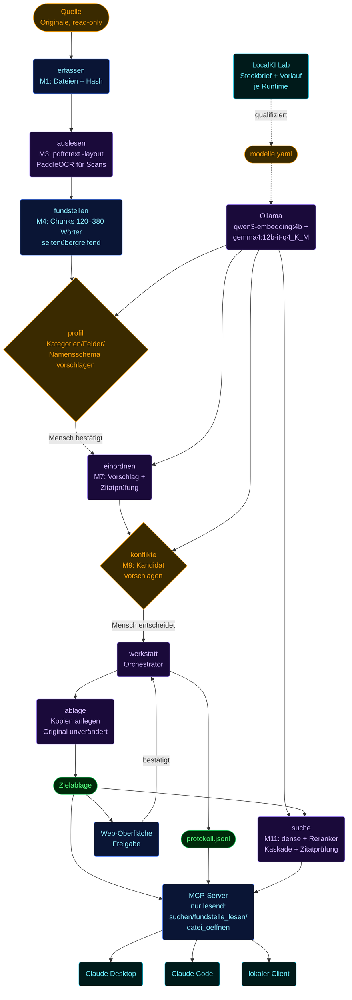

# Systemlandschaft

> **Stand 07.10.2026.** Architektur und Leitzahlen aus
> `~/Projects/lokalki-lab/docs/messungen/2026-10-07-gesamtprotokoll-dokumentenassistent.md`.
> Der Antwortweg ist seit dem 03.10. **zweistufig**: Stufe 1 liest nur Absätze mit Reranker-Score
> ≥ 0,5 × bester Score; liefert die Zitatprüfung kein gültiges Zitat, läuft Stufe 2 mit Top 20 und
> strenger Abweisungsregel; sonst „nicht gefunden". Leitzahl: **62 von 85 Fragen mit gültigem Beleg
> (73 %)** am echten Bestand, **15 von 15** Abweisungen.

## Architektur

Modulnamen und Reihenfolge (M1–M11) laut Docstrings in
`src/dokumentenassistent/*.py` (`werkstatt.py`: „Orchestrator: verdrahtet
M1–M11 in der Reihenfolge des Nutzerflusses"). Der Pfad Ollama → suche/
einordnen/konflikte/profil ist ein lokaler HTTP-Aufruf (`modelle.yaml`:
`host: http://localhost:11434`), kein Cloud-Zugriff. [Quelle: `README.md`,
`modelle.yaml`]

## Angedockte Prozesse

| Prozess | Werkzeug/Modul | Wer handelt | Nachweis |
|---|---|---|---|
| Eingang | `erfassen` → `auslesen` → `fundstellen` → `einordnen` | Modell schlägt vor, Controller (Werkstatt) verdrahtet | Vorschlag mit Fundstellen-IDs pro Feld |
| Freigabe | `web.py` (Bereich „Bestand"), `ablage.py` | Mensch entscheidet, Werkzeug kopiert | Kopie in Zielablage + Protokollzeile |
| Auskunft | `suche.py`, `mcp_server.py` | Mensch fragt, Modell antwortet nur mit geprüften Zitaten | Belegkarte (Fundstellen-ID, Wortlaut) |
| Revision/Nachweis | `.dokumentenassistent/protokoll.jsonl` | Werkstatt protokolliert jede Aktion append-only | Protokollzeile je Aktion (`art`, Zeitstempel) |
| Modellpflege | `modelle.yaml`, LocalKI Lab | Mensch wählt, Lab liefert Messwerte | Lab-Bericht (Steckbrief, Gate-Verdikt) als Beleg für die Wahl |

## Was die Knowledge Base kann, wenn sie sauber läuft

- Belegte Antworten in jeder Claude-Sitzung: jede Aussage trägt eine
  Fundstellen-ID, die wörtlich im Quelltext steht — kein Zitat ohne
  bestandene Zitatprüfung (`zitatpruefung.py`).
- Prüfpfad je Antwort: `fundstelle_lesen(id)` liefert den geprüften
  Absatztext, `datei_oeffnen` die Kopie in der Zielablage — nachvollziehbar
  bis zur Quelle.
- Modellwechsel ohne Ablagewechsel: `modelle.yaml` tauscht Embedding/LLM,
  Index, Namensschema und Zielablage bleiben unverändert (siehe
  `docs/userstory.md`, Use Case 6).
- Nachweis gegenüber Dritten (z. B. Steuerberater): Zielablage plus
  `protokoll.jsonl` zusammen ergeben einen Prüfpfad, wer was wann
  freigegeben hat.
- Lasttest-Zahlen als Grenze, nicht als Versprechen — und sie gelten nur für den
  **synthetischen** Korpus: Stufe 25 mit `qwen3.5:9b` erreichte 12/12 Fragen-Treffer und 2/2 Konflikttreffer in
  326 s Einordnen; ein anderes Modell (`qwen3.5:9b-mlx`) auf demselben
  Korpus nur 9/12 bei fast viermal so langer Laufzeit — Zahlen gelten nur
  für die gemessene Kombination aus Modell, Runtime und Korpusstufe.
  [Quelle: `beweise/last/2026-09-20/bericht.md`]
- Aggregatfragen über mehrere Dateien sind explizit **nicht** belastbar
  bewertet: der Lasttest markiert Summenfragen separat, weil das Werkzeug
  sie nicht beantworten kann (siehe `docs/userstory.md`, Use Case 3).

## Was sie nicht tut

- Kein Schreiben über MCP — die drei Werkzeuge `suchen`, `fundstelle_lesen`,
  `datei_oeffnen` sind rein lesend; kein Werkzeug schreibt, gibt frei oder
  korrigiert. [Quelle: `README.md`]
- Keine Cloud — Modelle laufen ausschließlich über lokales Ollama
  (`modelle.yaml: host: http://localhost:11434`); Ausnahme: sobald ein
  Cloud-MCP-Client (Claude Desktop/Code) die Belegkarten liest, verlassen
  genau diese Daten den Rechner — siehe Privacy-Vorbehalt in
  `docs/userstory.md`, Use Case 4.
- Keine Freigabe durch das Modell — jede Kategorisierung bleibt „Vorschlag",
  bis ein Mensch bestätigt; Konflikte werden nie automatisch entschieden
  (`konflikte.py`: „Konflikte werden nie automatisch entschieden").
- Originale nie verändert — nur Kopien (`shutil.copy2`, byte- und
  mtime-gleich), nie Verschieben, Umbenennen oder Löschen des Originals.
  [Quelle: `ablage.py` Docstring]
