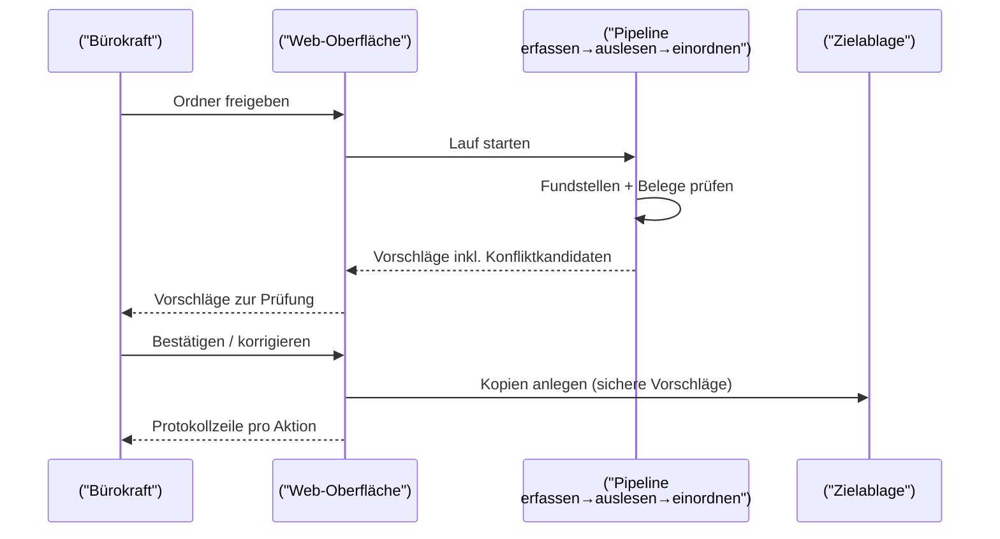
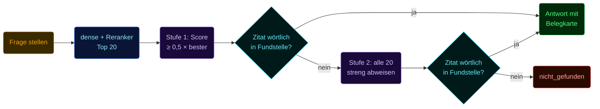
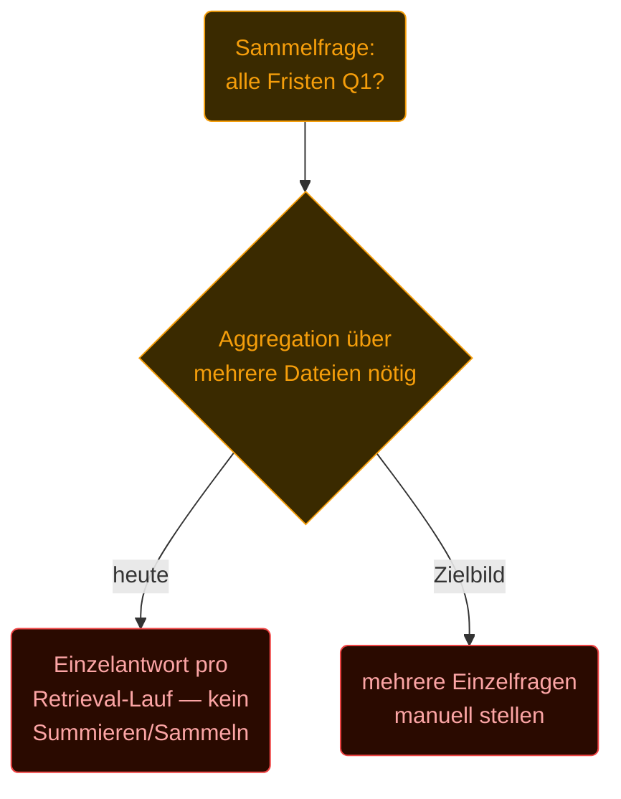
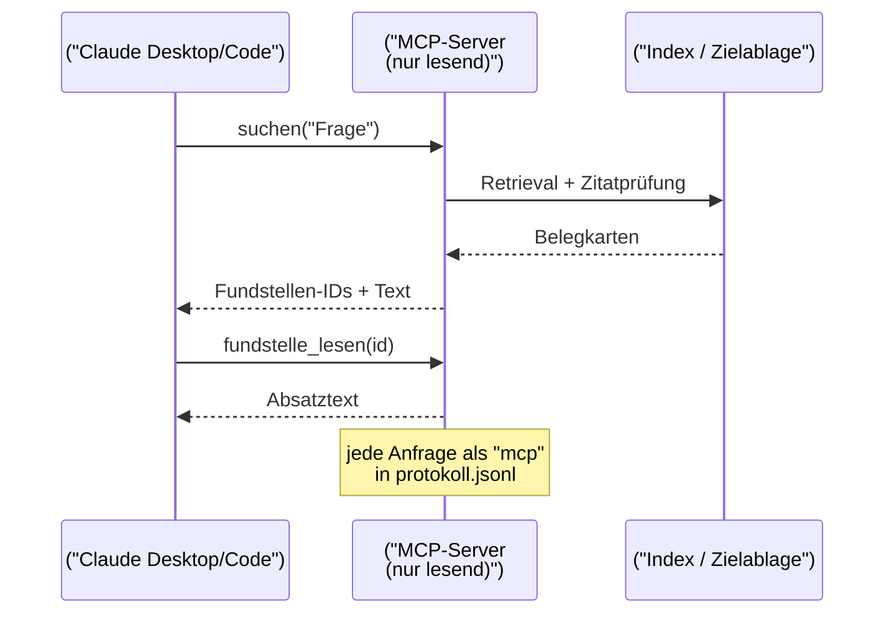
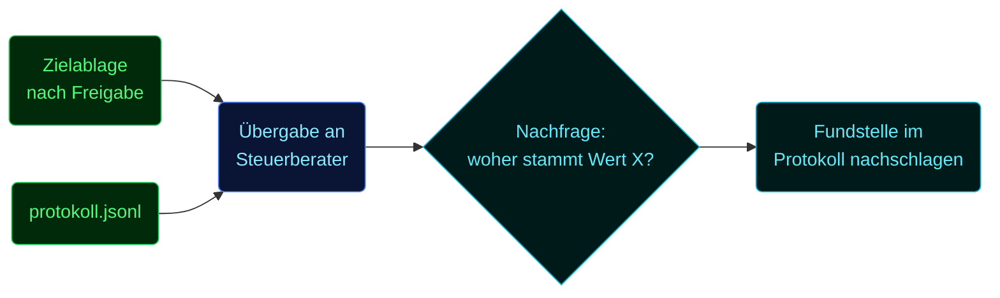
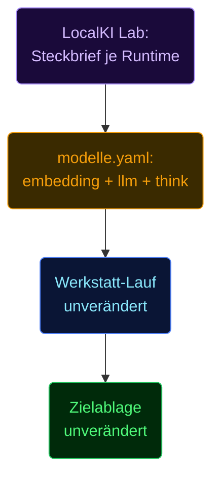

# User Story: Dokumentenassistent

> **Stand 07.10.2026.** Ablauf und Module stimmen; die Zahlen in
> den Use Cases stammen aus dem synthetischen Lasttest. Leitzahlen am echten Bestand:
> 62 von 85 Fragen belegt (73 %), 15/15 Abweisungen — Gesamtprotokoll im Lab-Repo.

## Kernstory — Malerbetrieb Hoffmann

**Persona:** Thomas Hoffmann, Inhaber Malerbetrieb Hoffmann GmbH (Pinselgasse 5,
12345 Neustadt, sechs Mitarbeiter), und seine Bürokraft. Beide sind keine
IT-Fachleute. [Quelle: `beispiele/malerbetrieb/README.md`]

**Ausgangslage:** 200 Dateien liegen unsortiert in vier kryptisch benannten
Ordnern — `Alt/` (13), `Downloads/` (132), `Fotos Handy/` (18), `Scans/` (37).
Dateinamen wie `Rechnung (4).pdf`, `Unbenannt.pdf`, `IMG_2231.jpg` verraten
nichts über den Inhalt. [Quelle: `beispiele/malerbetrieb/README.md`]

**Ziel:** „Alle Unterlagen des Geschäftsjahres 2025 für Buchhaltung und
Steuerberater ordnen." [Quelle: `beispiele/malerbetrieb/README.md`, Profilzweck]

**Ablauf und Abnahmekriterien** (entspricht dem implementierten Fluss,
Module M1–M11 laut Docstrings in `src/dokumentenassistent/`):

1. **Profilvorschlag** — der Assistent liest eine Stichprobe, schlägt
   Kategorien, Dokumenttypen, Felder und ein Namensschema vor (`profil.py`).
2. **Bestätigung** — die Bürokraft bestätigt oder korrigiert den Vorschlag,
   bevor irgendetwas einsortiert wird.
3. **Einordnen mit wörtlichen Fundstellen** — jede Datei wird gelesen
   (`auslesen.py`, `pdftotext -layout` oder PaddleOCR für Scans), in zitierbare Chunks
   von 120–380 Wörtern zerlegt, seitenübergreifend (`fundstellen.py`) und das Modell schlägt Kategorie, Typ und Felder
   vor; jeder behauptete Beleg wird deterministisch gegen den Fundstellentext
   geprüft (`zitatpruefung.py`, `einordnen.py`) — kein Feld gilt als „sicher",
   dessen Wortlaut nicht im Absatz steht.
4. **Konflikte entscheiden** — abweichende Beträge bei gleichem Aussteller und
   Bezugsnummer werden als Konfliktkandidat vorgeschlagen, nie automatisch
   entschieden (`konflikte.py`); der Mensch wählt „ersetzt",
   „verschiedene Sachverhalte", „eigener Wert" oder „nicht entscheidbar".
5. **Freigabe** — erst nach Bestätigung entstehen Kopien in der Zielablage;
   nur Vorschläge mit Status „sicher" werden kopiert (`ablage.py`).
6. **Originale unverändert** — `shutil.copy2`, byte- und mtime-gleich; kein
   Verschieben, Umbenennen, Löschen des Originals. [Quelle: `ablage.py` Docstring]
7. **Fragen mit Belegen** — zweistufig (`suche.py`, Stand 03.10.2026):
   dichte Suche über `qwen3-embedding:4b` mit Pfad-Präfix, **ohne
   Ähnlichkeitsschwelle**, dann Cross-Encoder-Reranker `bge-reranker-v2-m3`
   über die besten 20. **Stufe 1** gibt dem Antwortmodell nur die Absätze mit
   Reranker-Score ≥ 0,5 × bester Score; jedes Zitat wird deterministisch
   geprüft. Liefert Stufe 1 kein gültiges Zitat, läuft **Stufe 2** mit allen
   20 Absätzen und einer strengen Abweisungsregel. Eine erfundene
   Fundstellen-ID wird verworfen; ohne gültige ID lautet die Antwort
   „nicht_gefunden". BM25 und RRF sind seit dem 21.09.2026 ausgebaut — jede
   Fusion lag unter der reinen Bedeutungssuche.
8. **Protokoll** — jede Aktion (Erfassen, Freigabe, MCP-Zugriff, Korrektur)
   steht als Zeile in `.dokumentenassistent/protokoll.jsonl` — Prüfpfad statt
   Blackbox.

Gemessen am Malerbetrieb-Korpus, Stufe 25, Modell `qwen3.5:9b` (20.09.2026): 12/12
Testfragen richtig beantwortet, 2/2 Konflikte gefunden, 326 s Einordnen für
25 Dateien (13,1 s/Datei). [Quelle: `beweise/last/2026-09-20/bericht.md`]

---

## Weitere Use Cases

### 1. Posteingang einordnen — **implementiert**

Die Bürokraft wirft den Wochenposteingang (Scans, Handyfotos, E-Mail-Anhänge)
in den Quellordner und startet den Lauf über die Web-Oberfläche.

Deckt sich mit `werkstatt.py` (Orchestrator M1–M11) und dem Web-Bereich
„Eingang" (`web.py`). Quelle für Zahlen: die Lasttest-Läufe in
`beweise/last/`.

### 2. Rechnung gegen Vertrag prüfen — **implementiert**

Frage: „Ist die Anfahrt bei der Gerüstbau-Rechnung im Rahmenvertrag enthalten?"
Der Assistent sucht über beide Dokumente (Rechnung + 30-seitiger
Rahmenvertrag), sortiert die besten 20 über den Reranker und gibt dem Modell
nur die Absätze mit Score ≥ 0,5 × bester Score; zitiert wird wörtlich, z. B. „§ 5 (Anfahrt im
Vertragsgebiet enthalten)". [Quelle: `beispiele/malerbetrieb/README.md`,
Abschnitt „Konflikte"; `suche.py` Docstring]

### 3. Fristenfrage über mehrere Dokumente — **geplant (eingeschränkt)**

„Welche Kündigungsfristen laufen im Q1?" verlangt, mehrere Verträge zu
durchsuchen und ihre Fristen zu **aggregieren**. Heute beantwortet
`suche.py` je eine Frage mit den Top-n Fundstellen aus einem Retrieval-Lauf —
für „welche Frist steht in Vertrag X" funktioniert das (Use Case 2), für
eine Summen- oder Sammelfrage über viele Dateien nicht: Der Lasttest markiert
Summenfragen ausdrücklich als vom Werkzeug nicht beantwortbar und wertet sie
separat über `pruefung: karte_datei_enthaelt` statt über einen echten
Sollstatus. [Quelle: `beispiele/malerbetrieb/README.md`, Abschnitt „Fragen",
Fragen 16/17]

**Heutiger Workaround:** einzelne, dateibezogene Fragen stellen; eine
automatische Mehrdokument-Aggregation ist nicht Teil des Systems.

### 4. Auskunft aus Claude Code/Desktop über MCP — **implementiert, mit Privacy-Vorbehalt**

Der MCP-Server stellt genau drei lesende Werkzeuge bereit: `suchen(frage)`,
`fundstelle_lesen(id)`, `datei_oeffnen(fundstelle_id)`. Sichtbar ist nur, was
in der Web-Oberfläche freigegeben wurde; `datei_oeffnen` nennt die Kopie in
der Zielablage, nie das Original. Kein Werkzeug schreibt, gibt frei oder
korrigiert. [Quelle: `README.md`, Abschnitt „MCP-Server"]

**Ehrlich gesagt:** Belegkarten und Fundstellentexte gehen an den
MCP-Client — bei Claude Desktop oder Claude Code also in die Cloud, sobald
das Modell sie liest. Privat bleibt der Bestand nur mit einem lokalen
Client (lokales LLM, lokaler MCP-Client, lokale Dateien). [Quelle: `README.md`]

### 5. Übergabe an den Steuerberater — **implementiert**

Nach Freigabe liegt die Zielablage sauber benannt nach dem bestätigten
Namensschema vor; `.dokumentenassistent/protokoll.jsonl` ist der Prüfpfad —
wer was wann freigegeben, korrigiert oder abgefragt hat.

### 6. Modellwechsel ohne Ablagewechsel — **implementiert**

`modelle.yaml` schaltet Embedding- und LLM-Modell über eine einzige Zeile um
(aktuell `bge-m3` + `qwen3.5:9b`, `think: false` — Pflicht, weil `qwen3.5:9b`
bei `think: "low"` die gesamte Antwort ins Feld `thinking` legt und `response`
leer lässt, gemessen 19.09.2026 mit Ollama 0.34.0). [Quelle: `modelle.yaml`]
Die Zielablage-Struktur, das Namensschema und der Index bleiben dabei
unverändert — nur der Provider-Aufruf ändert sich.

Bericht vom 20.09.2026 vergleicht bereits zwei Runtimes auf demselben Korpus:
`qwen3.5:9b` (326 s Einordnen, Stufe 25) gegen `qwen3.5:9b-mlx` (1207 s,
deutlich langsamer, 9/12 statt 12/12 Fragen-Treffer). [Quelle:
`beweise/last/2026-09-20/bericht.md`] Die Modellwahl selbst stützt sich auf
den LocalKI Lab (Schwesterprojekt): dessen Steckbrief- und Vorlaufprüfungen
pro Runtime liefern die Evidenzbasis, bevor ein Modell in `modelle.yaml`
landet. [Quelle: `lokalki-lab/CLAUDE.md`, Abschnitt „What the lab is"]
